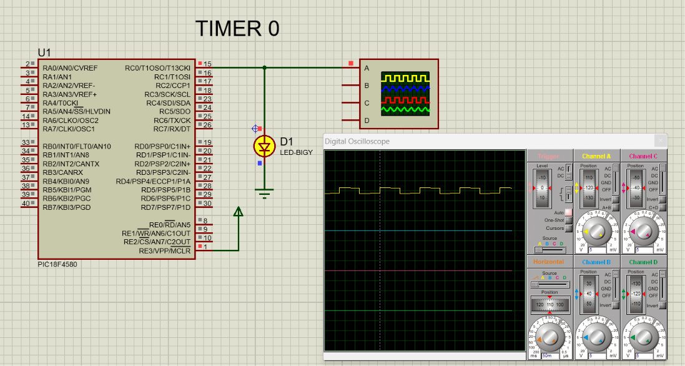
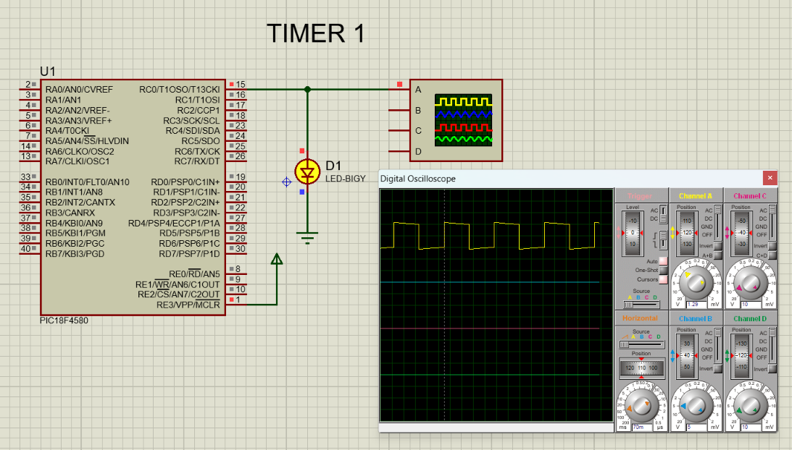
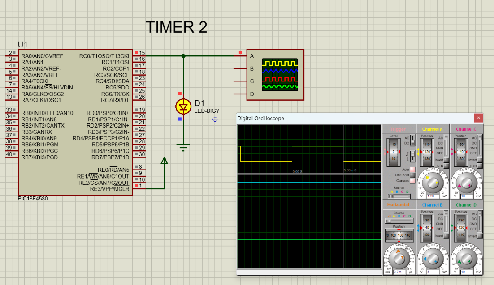
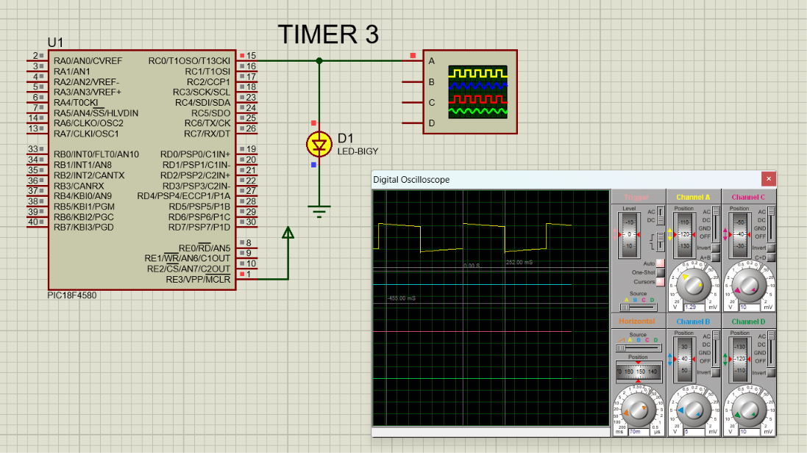

# PIC18F4580 Timer Programming & Proteus Simulation

This repository contains practical implementations of **Timer0, Timer1, Timer2, and Timer3** using the **PIC18F4580 microcontroller**.

Each timer is configured to generate a delay, and the output is verified using an LED and a digital oscilloscope in **Proteus simulation**.

---

## 🛠️ Tools & Technologies

- **Microcontroller:** PIC18F4580
- **Programming Language:** Embedded C
- **Compiler:** MPLAB C18
- **Simulation:** Proteus
- **Oscillator:** 20 MHz
- **Output:** LED on RC0
- **Timer Mode:** Hardware timer with polling of the timer flag

---

## 📁 Project Structure

```text
PIC18F4580-Timers/
│
├── TIMER0/
│   ├── timer0.png
│   ├── timer0_pic.c
│   └── timer0_pic.pdsprj
│
├── TIMER1/
│   ├── timer1.png
│   ├── timer1_pic.c
│   └── timer1_pic.pdsprj
│
├── TIMER2/
│   ├── timer2.png
│   ├── timer2_pic.c
│   └── timer2_pic.pdsprj
│
├── TIMER3/
│   ├── timer3.png
│   ├── timer3_pic.c
│   └── timer3_pic.pdsprj
│
└── README.md
```

---

# ⏱️ Timer0

Timer0 is configured in **16-bit mode** to generate a delay.

### Configuration

- 16-bit Timer0
- Internal instruction clock
- Prescaler: **1:256**
- LED output: **RC0**
- Timer flag: **TMR0IF**

### Working

1. Load the preload value into `TMR0H` and `TMR0L`.
2. Start Timer0.
3. Wait until `TMR0IF` becomes 1.
4. Clear the timer flag.
5. Stop Timer0.
6. Repeat the process.

### Proteus Simulation



---

# ⏱️ Timer1

Timer1 is configured in **16-bit mode** to generate a delay.

### Configuration

- 16-bit Timer1
- Internal instruction clock
- Prescaler: **1:8**
- LED output: **RC0**
- Timer flag: **TMR1IF**

### Working

1. Load the preload value into `TMR1H` and `TMR1L`.
2. Clear the Timer1 flag.
3. Start Timer1.
4. Wait for `TMR1IF`.
5. Stop Timer1.
6. Repeat.

### Proteus Simulation



---

# ⏱️ Timer2

Timer2 is an **8-bit timer** that uses the `PR2` register to determine its period.

### Configuration

- 8-bit Timer2
- Internal instruction clock
- Prescaler: **1:1**
- Postscaler: **1:10**
- Period register: `PR2`
- LED output: **RC0**
- Timer flag: **TMR2IF**

### Working

Timer2 increments `TMR2` until it matches `PR2`. A timer period event occurs, the timer flag is set, and the program clears the flag before repeating.

### Proteus Simulation



---

# ⏱️ Timer3

Timer3 is configured in **16-bit mode** to generate a delay.

### Configuration

- 16-bit Timer3
- Internal instruction clock
- Prescaler: **1:8**
- LED output: **RC0**
- Timer flag: **TMR3IF**

### Working

1. Load the preload value into `TMR3H` and `TMR3L`.
2. Start Timer3.
3. Wait until `TMR3IF` becomes 1.
4. Clear the timer flag.
5. Stop Timer3.
6. Repeat.

### Proteus Simulation



---

# 📊 Timer Comparison

| Timer | Resolution | Main Registers | Flag Register | Prescaler |
|------|------|------|------|------|
| **Timer0** | 16-bit | `TMR0H`, `TMR0L` | `TMR0IF` | 1:256 |
| **Timer1** | 16-bit | `TMR1H`, `TMR1L` | `TMR1IF` | 1:8 |
| **Timer2** | 8-bit | `TMR2`, `PR2` | `TMR2IF` | 1:1 |
| **Timer3** | 16-bit | `TMR3H`, `TMR3L` | `TMR3IF` | 1:8 |

---

# 🔄 Basic Timer Operation

For Timer0, Timer1 and Timer3:

```text
Load Preload Value
        ↓
Start Timer
        ↓
Timer Counts
        ↓
Overflow
        ↓
Timer Flag = 1
        ↓
Clear Flag
        ↓
Stop Timer
        ↓
Repeat
```

For Timer2:

```text
Set PR2
   ↓
Start Timer2
   ↓
TMR2 Counts
   ↓
TMR2 = PR2
   ↓
TMR2IF = 1
   ↓
Clear Flag
   ↓
Repeat
```

---

# 🎯 Learning Objectives

This project demonstrates:

- PIC18F4580 timer peripherals
- Timer register configuration
- 8-bit and 16-bit timer operation
- Timer prescaler configuration
- Timer preload calculation
- Period register (`PR2`) operation
- Timer overflow/period flags
- Polling-based delay generation
- LED control using hardware timers
- Proteus-based hardware simulation
- Oscilloscope verification

---

# 📌 Output

The LED connected to **RC0** is controlled using delays generated by the PIC18F4580 hardware timers.

The Proteus oscilloscope is used to observe and verify the timing waveform for each timer.

---

## 👨‍💻 Author

**Raju Malekar**

Electronics Engineer | Embedded Systems Enthusiast

Focus areas:

- Embedded C
- Microcontrollers
- PIC18F4580
- Arduino
- Embedded Systems
- Electronics & Circuit Design
- Proteus Simulation

---

⭐ If you find this project useful, consider giving the repository a star!
